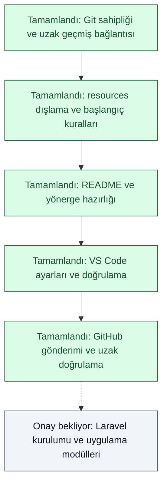

# Süreç Takibi

## ÇALIŞMA KAYDI

Saatler Türkiye saatidir (Europe/Istanbul).

| Tarih/saat | Dosya / konum | Yapılan işlem |
| --- | --- | --- |
| 2026-11-07 04:25 | `.git/`, `.git.del/` | Commit içermeyen sandbox sahipliğindeki Git klasörü silinmeden korundu; depo `DELLG515\\ufukt` hesabıyla yeniden oluşturuldu. |
| 2026-11-07 04:25 | `.git/config`, `LICENSE` | Mevcut uzak `main` geçmişi temel alındı; MIT lisansı korundu. |
| 2026-11-07 04:29 | `.gitignore`, `.gitattributes`, `.editorconfig` | Laravel/Vite alt dizin yapısı ve ortak metin kuralları hazırlandı; kök kaynak koleksiyonu ile eski boş Git klasörü dışlandı. |
| 2026-11-07 04:29 | Proje belgeleri ve `app/` taslakları | Mevcut proje temeli `2769628` commit'ine alındı; `resources/` dahil edilmedi. |
| 2026-11-07 04:29 | `README.md` | Amaç, yönetim ve okuma akışları, yerel kaynakların rolü, mevcut durum ve yol haritası yazıldı. |
| 2026-11-07 04:29 | `.github/copilot-instructions.md`, `AGENTS.md`, `CLAUDE.md`, `AI_RULES.md`, `PLAN.md`, `TODO.md` | Yönerge adı/bağlantıları, kaynak koleksiyonunun Git kapsamı ve açık iş kayıtları güncellendi. |
| 2026-11-07 04:30 | `.vscode/settings.json` | UTF-8/LF, dil girintileri, Blade/Emmet, kaynak salt okunurluğu, arama/izleme ve Copilot yönerge ayarları düzenlendi. JSON, bağlantı ve 21 ignore senaryosu geçti. |
| 2026-11-07 04:34 | GitHub `main` | İlk üç hazırlık commit'i gönderildi. Yerel/uzak `bb9c6c7` eşleşmesi, ilk commit'in korunması ve GitHub kök dosya listesi doğrulandı; `resources/` ve `.git.del/` tüm Git geçmişinin dışında. |
| 2026-11-07 04:34 | VS Code | Uygulama açıldı; proje `main` dalı ve Synchronize Changes ile tanındı. Yeni Git klasörünün sahibi `DELLG515\\ufukt` olarak doğrulandı. |
| 2026-11-07 04:34 | `app/`, doğrulama kapsamı | PHP taslakları başlangıç commit'ine göre değişmedi. JSON, Markdown bağlantıları, BOM, staged diff ve ignore kontrolleri geçti. Laravel iskeleti bulunmadığından uygulama testleri çalıştırılmadı. |

## MODÜL DURUMU

